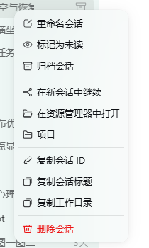
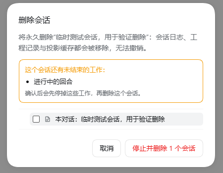
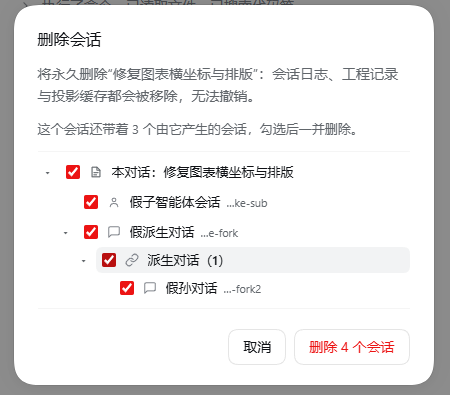

# dsh-codex-session-deletetool

给 [Codex UI](https://github.com/michengai/dsh-codex-ui) 的会话菜单补回**真正删除对话**的能力。

装了这个插件之后，会话行上的「⋯」和右键菜单里都会出现 **删除会话**：删掉的是会话日志、工程记录与投影缓存，不是归档隐藏。

> **这是一个为 Codex UI 做界面适配的插件。** 删除引擎借鉴自 [better-dsh-session-deletetool](https://github.com/Lzcdebear/better-dsh-session-deletetool)（作者 Lzcdebear，MIT），本包把它内置进来，改写成可以独立工作的一半，所以**不需要先装 better-dsh-session-deletetool**。

[](LICENSE)

---

## 界面截图

| 会话菜单里多出「删除会话」 | 有未结束工作时的确认框 | 带家族时按层级勾选 |
|---|---|---|
|  |  |  |

三张图都来自真实运行：菜单里多出的红色「删除会话」是 Codex UI 自己渲染的，本插件只负责让守卫通过；中间那张展示「还有未结束的工作」的提示与「停止并删除」按钮；右边那张是一个带 3 个后代会话的家族树，子智能体（👤 图标）与派生对话（🔗 图标）按层级缩进、逐项勾选。

---

## 解决什么问题

`@michengai/dsh-codex-ui` 用自己的一套侧边栏替换了 DSH 官方侧边栏，会话行上的菜单也是它自己渲染的。于是出现了一个尴尬的局面：

| | 官方侧边栏 | Codex UI |
|---|---|---|
| `better-dsh-session-deletetool` 的删除行 | ✅ 显示（注册在 `sidebar.workspaces.session.menu.item`） | ❌ 不显示（Codex UI 不渲染这个插槽） |
| Codex UI 自带的删除项 | — | ❌ 不显示（见下） |

Codex UI 的菜单里其实**有**删除项，但它被一个守卫挡着：

```js
// @michengai/dsh-codex-ui
function hasArchiveSessionDelete(value) {
  return value !== null && typeof value === "object"
    && typeof value.deleteSession === "function"
}
canDeleteSession: () => hasArchiveSessionDelete(ctx.get("remote.workspaceRegistry"))
```

源码注释写得很清楚：「永久删除会话由归档管理插件通过 `remote.workspaceRegistry.deleteSession` 提供」。而默认安装里没有任何插件提供这个命名空间，所以那一行永远不出现——**两个插件都在，删除入口却没了**。

## 这个插件做什么

做三件事，都很克制：

**1. 提供 Codex UI 在等的那个服务。**

在 Client 端 `provide('remote.workspaceRegistry', { deleteSession })`，Codex UI 的 `hasArchiveSessionDelete` 守卫随之通过，会话菜单重新长出「删除会话」。

如果这个命名空间已经被别的插件（例如归档管理插件）以可用的 `deleteSession` 占用，本插件**不会覆盖**它——别人那套更完整，不该被遮蔽。

**2. 把被 Codex UI 藏掉的「⋯」按钮放出来。**

Codex UI 的会话行本来就有 `⋯` 按钮，但它自己用样式把它藏了：

```css
.dcu-wb-actions{display:none}                          /* 只在项目标题悬停、或该行菜单已打开时显示 */
.dcu-wb-context-anchor{opacity:0;pointer-events:none}  /* 有盒子，但看不见也点不到 */
```

所以原状下只能靠**右键**唤出菜单。本插件注入一条优先级更高的规则，让悬停会话行时 `⋯` 正常显示、可点击：

```css
.dcu-wb-session:hover .dcu-wb-actions,
.dcu-wb-session:focus-within .dcu-wb-actions,
.dcu-wb-session.dcu-wb-menu-open .dcu-wb-actions{display:flex}
.dcu-wb-session .dcu-wb-actions .dcu-wb-more.dcu-wb-context-anchor{opacity:1;pointer-events:auto}
```

现在**右键**和**三个小点**两条路都能调出同一个菜单，「删除会话」在两条路上都在。

**3. 内置 Host 删除引擎，并保留批量接口。**

删除动作由本包自带的 Host 半完成，不依赖另一个插件是否安装。四条同源路由（见下方「工作原理」）都挂在 `ctx.webServer` 上：

| 路由 | 方法 | 用途 | UI 是否调用 |
|---|---|---|---|
| `/dsh-codex-session-deletetool/inspect` | GET | 单个会话的状态 + 家族树 | ✅ 家族树对话框 |
| `/dsh-codex-session-deletetool/delete` | POST | 删除一个会话（可带勾选的子会话） | ✅ |
| `/dsh-codex-session-deletetool/catalog` | GET | 全部会话，按 Workspace 分组 | ❌ 暂无 UI 使用 |
| `/dsh-codex-session-deletetool/delete-batch` | POST | 按 `roots` 列表批量删除 | ❌ 暂无 UI 使用 |

批量接口是从上游完整保留的：`catalog` 返回每个会话的 `kind` / `depth` / `family` / `subagents` / `derived` / `open` / `running`，`delete-batch` 接收 `{ roots: [{ sessionId, descendants? }], stop? }`，逐个 root 独立执行、失败项单独回报（不是事务）。Codex UI 的入口一次只处理一个会话，所以目前没有界面调用它们；留着是给脚本和将来的多选界面用的，行为与单条删除完全一致。

## 删除时会发生什么

删除语义与 better-dsh-session-deletetool 一致：

1. 删掉会话自己的产物目录（所有格式版本）；
2. 从每个 Workspace 记录里移除它的账户、归档与置顶成员关系；
3. 删掉它的投影缓存检查点；
4. 发出 `api-session/removed` 事件，连着的 Client 立刻把那一行去掉。

被删的不只是目标会话：子智能体会话、派生对话（fork）以及它们自己带出来的下一层，都可以一起删。家族关系同时从两条来源读取——每个父会话自己的 `subagentCatalog` 投影，和 `SessionHeader.parentSession` 谱系——因为任何一条单独都不完整。

真正会拦住删除的只有**正在运行的工作**（运行中的回合、后台任务、终端），而且是逐个会话询问的：子会话里跑着的东西不会被漏掉。确认后先停掉再删，会话自己开的终端也一并关掉。

### 确认流程：不多弹一个窗

Codex UI 在调用 `deleteSession` 之前**已经弹过它自己的确认框**，所以：

- **普通对话**（没有子智能体、没有派生对话、没有未结束的工作）
  → 一次确认直接删除，不再多弹窗；
- **带家族的对话**（有子智能体会话 / 派生对话 / 未结束的工作）
  → 先让 Codex UI 的确认框关掉，紧接着弹出家族树确认框：子智能体与派生对话按层级画出来、可逐项勾选、运行中的工作会标出来，确认后才真正删除。

第二个窗只在「一次确认不够」的时候出现，这是刻意的：普通删除不该让人按两次。

## 安装

### 从插件市场安装（推荐）

本插件已投稿 [awesome-dsh-plugin](https://github.com/awesome-dsh-plugin/awesome-dsh-plugin) 目录——这是 DSH 插件市场的唯一目录源。收录后可以在 DSH 桌面端的 **插件 → 发现** 里搜「Codex UI 会话删除」，点安装即可；也能用市场自带的备份/恢复功能同步到另一台机器。

### 从 GitHub 安装

```powershell
dsh plugin --profile desktop add memoryovo/dsh-codex-session-deletetool
```

`--profile` 后面换成你自己的 profile 名（桌面端默认是 `desktop`，`dsh web` 常用 `web`）。

### 本地目录安装

```powershell
dsh plugin --profile desktop add link:<本目录绝对路径>
```

装完刷新页面（或重启桌面端）即可：右键任意会话 → 菜单里出现「删除会话」。

## 依赖

| 依赖 | 关系 | 说明 |
|---|---|---|
| `@michengai/dsh-codex-ui` | **必需** | 提供会话菜单。没有它，本插件只是提供了一个没人调用的服务，不影响官方侧边栏。 |
| `better-dsh-session-deletetool` | **不需要** | 删除引擎已内置在本包里。两者可以同时启用，互不冲突（路由前缀不同）。 |

## 已知限制

会话如果**当前仍被 Harness 打开**（`inspect` 报 `open: true`），删除只会移除磁盘上的日志：

- 那一行会立刻从侧边栏消失，但 Host 内存里仍持有这个会话对象；
- 刷新页面（或下次列表同步）时它可能**重新出现**，因为列表来源是「内存中的活动会话优先」；
- DSH 目前没有公开的「释放 / 关闭活动会话」的 Host API（`sessions` 服务只有 `enter` / `detachEntered`，会话的销毁由 agent-loop 的 fiber 拥有），插件侧无法做到彻底永久删除。

规避办法：先在别的标签里离开该会话（或重启桌面端让 Host 重新加载），再删除。

另外：

- 一次最多删除 200 个子会话（`MAX_DESCENDANTS`），批量接口一次最多 200 个 root（`MAX_BATCH_ROOTS`），超出会返回 `409 too-many-descendants` / `400 too-many-roots`，需要分批；
- 四条路由都只接受**本页来源**的请求，跨站请求直接 `403 untrusted-origin`；
- `icon.svg` 只用于插件管理器列表，市场条目要求的位图图标需另外提供。

## 工作原理

```
┌──────────────────────────── Client ────────────────────────────┐
│  Codex UI 会话菜单                                              │
│      │ canDeleteSession() → ctx.get('remote.workspaceRegistry') │
│      ▼                                                          │
│  deleteSession(sessionId)   ← 本包 provide 的服务                │
│      │                                                          │
│      ├─ 普通对话 → POST /dsh-codex-session-deletetool/delete     │
│      └─ 带家族   → 弹家族树 → 同上，带上勾选的 descendants       │
└───────────────────────────────┬────────────────────────────────┘
                                │ 同源 HTTP（ctx.webServer）
┌───────────────────────────────▼────────────────────────────────┐
│  Host：本包 host.js（改编自 better-dsh-session-deletetool）      │
│  GET  /dsh-codex-session-deletetool/inspect   会话状态 + 家族     │
│  POST /dsh-codex-session-deletetool/delete    删日志/记录/缓存    │
│  GET  /dsh-codex-session-deletetool/catalog   全部会话（分组）    │
│  POST /dsh-codex-session-deletetool/delete-batch  批量删除        │
└────────────────────────────────────────────────────────────────┘
```

为什么走 HTTP 而不是 `ctx.remote`：一个免构建的纯 JavaScript 客户端包无法声明带类型的 Remote 命名空间（那需要 Typert 描述符生成），所以本包用同源 HTTP 路由与本包的 Host 半通信。

## 目录结构

```
.
├── client.js          # Client 半：提供服务、修 ⋯ 按钮、渲染家族树确认框
├── host.js            # Host 半：删除引擎与四条路由（改编自 better-dsh-session-deletetool）
├── index.js           # Host 入口：export { apply, inject } from './host.js'
├── cordis.patch.yml   # 把本插件插入 profile 的层栈
├── locale/            # 插件管理器里的名称与描述（zh / en）
├── icon.svg
└── LICENSE            # MIT，含第三方说明
```

## 致谢

- [better-dsh-session-deletetool](https://github.com/Lzcdebear/better-dsh-session-deletetool)（Lzcdebear）：删除引擎、家族树确认框的思路与样式，以及批量接口。本包 `host.js` 直接改编自它（0.5.3），主要改动是把路由前缀换成 `/dsh-codex-session-deletetool/*` 以便两者共存，并把入口从侧边栏插槽换成 Codex UI 的 `remote.workspaceRegistry` 服务。
- [Codex UI](https://github.com/michengai/dsh-codex-ui)（michengai）：提供了 `remote.workspaceRegistry.deleteSession` 这个扩展点，本插件才有地方接。

## License

[MIT](LICENSE)
